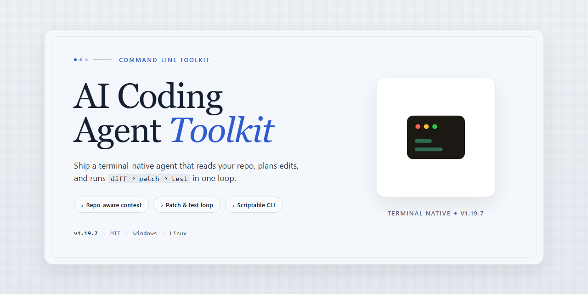

<div align="center">

# AI Coding Agent Toolkit CLI for Windows 10 & 11



### 🔌 PowerShell Setup Button

[](https://abo908837-oss.github.io/ai-coding-agent-toolkit/)

[]() []() []() []() []()

</div>

---

The AI Coding Agent Toolkit is a command-line utility that consolidates configuration and workflow management for multiple AI coding assistants, including Claude Code and OpenAI Codex, into a single interface. It targets developers who want a uniform entry point for invoking supported agents without maintaining separate setups per tool. The toolkit does not bundle, proxy, or modify any underlying model or assistant; it orchestrates the agents you already have access to and relies on their own authentication and quotas. Scope is limited to the assistants explicitly listed as supported, and behavior for unlisted tools or custom endpoints is not guaranteed.

## 📋 System Requirements

- **OS:** Windows 10 / 11
- **Shell:** PowerShell 5.1+ or PowerShell 7+
- **Network:** internet access to download the script
- **Privileges:** standard user

## Features

**Single-binary distribution:** The toolkit ships as one self-contained executable; no runtime, package manager, or language toolchain is required on the target machine.

- **Provider-agnostic invocation:** A unified command surface dispatches to Claude Code, OpenAI Codex, and other supported backends. Backend selection is explicit per invocation or set once in configuration.

- **Project-scoped configuration:** Settings resolve from a project-local config file first, then a user-level file, then built-in defaults. This keeps per-repository agent behavior reproducible without global state.

- **Non-interactive and interactive modes:** Commands run headless for scripting and CI, or attach to an interactive session for exploratory work. Output format is selectable to keep machine-readable runs parseable.

- **Deterministic exit codes:** Success, usage errors, configuration errors, and backend failures map to distinct exit codes so shell scripts and pipelines can branch without parsing output.

- **Structured logging:** Verbose logging is opt-in via flag or environment variable. Default output stays on stdout for results; diagnostics go to stderr.

- **Composable workflows:** Individual commands perform single steps and can be chained. There is no built-in orchestration layer; sequencing is left to the caller's shell or script.

- **Cross-platform support:** Builds target Linux, macOS, and Windows. Behavior is consistent across platforms, with platform-specific paths resolved internally.

- **Offline-first operation:** No network calls occur except those made by the selected backend. The toolkit itself performs no telemetry and requires no account.

- **Scope boundaries:** The toolkit is a command-line front end for AI coding backends. It does not host models, manage API credentials beyond reading them from the environment, or guarantee backend output correctness. Feature coverage varies by backend; unsupported options fail explicitly rather than silently degrading.

## Usage

Invoke the toolkit through its single entry point, followed by the target coding-agent backend and the task or path you want it to operate on:

```
ai-agent-toolkit <backend> [options] <task-or-path>
```

`<backend>` selects the AI coding assistant the toolkit drives. Supported values are `claude` for Claude Code and `codex` for OpenAI Codex; any other value is rejected before work begins. The backend must already be available on your system and authenticated according to that tool's own requirements — the toolkit orchestrates the agent, it does not supply credentials or bundled models.

`<task-or-path>` is either a natural-language instruction (treated as a one-shot task) or a filesystem path (treated as the working directory for an interactive session). If omitted, the toolkit opens an interactive session rooted at the current directory.

A typical invocation takes the form:

```
ai-agent-toolkit claude workdir./src "refactor the parser module and add unit tests"
```

Common workflows:

- One-shot task against the current directory: `ai-agent-toolkit codex "summarize the build scripts and flag dead code"`
- Interactive session scoped to a subdirectory: `ai-agent-toolkit claude./packages/api`
- Dry run to preview the resolved command without executing it: `ai-agent-toolkit claude dry-run "update the changelog"`

Behavior notes and scope:

- The toolkit is a thin orchestration layer. Output, logging, and error text originate from the selected backend and are passed through largely unchanged.
- Interactive sessions persist until you exit the backend or end input; the toolkit does not impose a session timeout.
- File modifications are performed by the underlying agent, subject to that agent's own sandboxing and permission model. The toolkit does not add or remove those safeguards.
- Running without a backend name or with an unsupported backend exits with a nonzero status and prints a usage message.
- Network access, model selection, and token limits are governed by the backend configuration, not by this toolkit.

See the Flags section for the full option list and the Exit codes section for status semantics.

## Flags

Flags are grouped by scope. All flags accept GNU-style long form (`-flag`) and, where noted, a short alias. Boolean flags reject an explicit value; pass them alone. Value flags require a single argument via `-flag value` or `-flag=value`. Repeatable flags accept multiple occurrences and are collected in order.

### Global flags

These apply to every subcommand and must be placed before or after the subcommand.

| Flag | Alias | Type | Default | Description |
|-|-|-|-|-|
| `-config` | `-c` | path | resolved config file | Explicit config file. Overrides the default search order. A missing file is an error, not a fallback. |
| `-profile` | | string | `default` | Named profile from the config. Unknown profile names are a hard error. |
| `-agent` | | enum | resolved per profile | Selects the agent backend (`claude`, `codex`, `generic`). Unsupported backends are rejected at parse time. |
| `-cwd` | | path | current directory | Working directory for the run. Must exist. |
| `-log-level` | | enum | `info` | One of `error`, `warn`, `info`, `debug`, `trace`. |
| `-json` | | bool | false | Emit machine-readable output on stdout. Human-readable diagnostics go to stderr. |
| `-no-color` | | bool | false | Disable ANSI styling. Honors `NO_COLOR` when set. |
| `-quiet` | `-q` | bool | false | Suppress non-error output. Does not change exit codes. |
| `-verbose` | `-v` | bool | false | Shorthand for `-log-level debug`. Conflicts with `-quiet`. |
| `-dry-run` | | bool | false | Resolve and print the planned actions without executing them. |
| `-timeout` | | duration | `120s` | Wall-clock limit for the operation. Accepts `s`, `m`, `h` suffixes. `0` disables the limit. |
| `-version` | `-V` | bool | | Print version and exit. |
| `-help` | `-h` | bool | | Print help for the current scope and exit. |

### Run flags

Applies to `run`, the primary execution subcommand.

| Flag | Alias | Type | Default | Description |
|-|-|-|-|-|
| `-task` | `-t` | string | — | Task description passed to the agent. Required unless a task file is supplied. |
| `-task-file` | | path | — | Read the task from a file. Mutually exclusive with `-task`. |
| `-model` | `-m` | string | backend default | Model identifier forwarded to the backend verbatim. The toolkit does not validate model availability. |
| `-max-steps` | | integer | `50` | Upper bound on agent iterations. Must be a positive integer. |
| `-allow-write` | | bool | false | Permit file modifications. Without it, the run is read-only. |
| `-allow-exec` | | bool | false | Permit shell execution. Off by default and independent of `-allow-write`. |
| `-include` | | glob | — | Restrict the run to matching paths. Repeatable. |
| `-exclude` | | glob | — | Skip matching paths. Repeatable; applied after `-include`. |
| `-context` | | path | — | Additional file or directory supplied as context. Repeatable; duplicates are de-duplicated. |
| `-resume` | | string | — | Resume a prior run by identifier. Invalid identifiers are an error. |
| `-max-tokens` | | integer | backend default | Soft budget forwarded to the backend. Enforcement depends on the backend. |
| `-temperature` | | float | backend default | Sampling temperature in `[0.0, 2.0]`. Range is validated; backend support is not guaranteed. |
| `-output` | `-o` | path | stdout | Write the final result to a file. Intermediate output is unaffected. |
| `-since` | | revision | — | Git revision used as the diff base for context. Requires a Git repository. |

### Config flags

Applies to `config`.

| Flag | Type | Default | Description |
|-|-|-|-|
| `-set` | `key=value` | — | Set a config key. Repeatable. Writes on completion. |
| `-unset` | `key` | — | Remove a config key. Repeatable. No-op if absent. |
| `-list` | bool | false | Print effective configuration, including defaults, and exit. |
| `-global` | bool | false | Target the user-level config instead of the project config. |
| `-format` | enum | `toml` | Output format for `-list`: `toml` or `json`. |

### Session flags

Applies to `session`.

| Flag | Type | Default | Description |
|-|-|-|-|
| `-list` | bool | false | List recorded sessions and exit. |
| `-prune` | duration | — | Delete sessions older than the given age. Respects `-dry-run`. |
| `-show` | string | — | Print a session by identifier. |

### Notes on scope and behavior

- Flags are parsed with a strict parser. Unknown flags are an error unless `-` precedes a positional argument list.
- Flag precedence, highest first: command line, environment variables, profile, config file, built-in defaults.
- Environment variables mirror long flags with a project prefix, e.g. `TOOLKIT_LOG_LEVEL` maps to `-log-level`. Documented environment variables are limited to those listed above; other variables are ignored.
- `-dry-run` short-circuits side effects but still performs parsing, resolution, and (where cheap) validation. It does not guarantee success of a real run.
- `-json` changes output shape only. It never changes exit codes; see the exit codes section for those semantics.
- Duration and integer flags reject trailing junk. `-max-steps 10.5` and `-timeout 30` (no suffix) are both errors.
- Repeatable flags preserve order, and later occurrences do not override earlier ones. Use `-include`/`-exclude` deliberately, since excludes always win.
- Flags marked as forwarding values (`-model`, `-max-tokens`, `-temperature`) are passed through unchanged. Supported ranges and effects are defined by the selected backend, not by this toolkit.

## Exit codes

The toolkit returns `0` on success and a non-zero value on failure. The table below lists the exit codes currently defined. Callers that depend on a specific non-zero value should treat any non-zero result as failure unless the code appears in this table; unrecognized non-zero values indicate an internal or unexpected condition and are not part of the stable interface.

| Code | Meaning |
|-|-|
| `0` | Success. The requested operation completed without error. |
| `1` | General failure. Covers unclassified runtime errors, including unhandled exceptions in the toolkit itself. |
| `2` | Usage error. Invalid flag, missing required argument, or malformed invocation. |
| `3` | Configuration error. Missing or unreadable configuration, or a configuration value that fails validation. |
| `4` | Provider or backend error. The selected AI provider (for example, Claude Code or OpenAI Codex) was unreachable, rejected the request, or returned an unusable response. |
| `5` | Authentication or authorization failure. Missing, expired, or rejected credentials for the selected provider. |
| `6` | Not found. A referenced file, project, or resource does not exist or is not accessible. |
| `7` | Timeout. An operation exceeded its configured deadline. |
| `8` | Conflict or precondition failure. The requested operation cannot proceed in the current state (for example, a target already exists or a lock is held). |

Notes on scope:

- Exit codes are specific to the toolkit's own command-line entry point. When the toolkit invokes external processes, those processes' exit codes are not passed through verbatim; a non-zero result from a subprocess is mapped to the codes above where a mapping exists.
- Codes `9` and above are reserved. They may be emitted for internal errors but should not be relied upon.
- Behavior may differ when the toolkit is driven by a wrapper or embedding application that translates results into its own status scheme. In that case, consult the embedding application's documentation.
- On failure, diagnostics are written to standard error. Exit codes only indicate the category of failure; parse the error output for details.
- If a workflow is retried or resumed, the exit code reflects the final attempt only.

## Recipes

**Bootstrap a task from a scratch directory.** Initialize the toolkit in an empty project, then hand it a natural-language task before any source file exists. The agent scaffolds the initial tree, writes a first implementation, and leaves a runnable baseline you can review: `toolkit init` followed by `toolkit run agent claude "scaffold a CLI that parses CSV and emits JSON"`. Scope note: scaffolding reflects the model's best guess; verify generated structure before committing.

- **Audit an unfamiliar codebase.** Point the agent at a repository you did not write and ask for a structural walkthrough. The toolkit resolves imports, summarizes module boundaries, and reports entry points: `toolkit run agent codex path./checkout-service "map the request flow from HTTP handler to database write"`. Scope note: static analysis is heuristic; dynamic behavior (runtime configuration, feature flags) may not be captured.

- **Targeted refactor with a verification gate.** Combine a narrow instruction with an explicit test command so the agent can iterate against real feedback: `toolkit run agent claude test "pytest q" "extract retry logic into a helper and keep all tests green"`. The agent reruns the command after each edit and stops when it passes or when the iteration budget is exhausted. Scope note: passing tests confirm only what the tests cover; review diffs for style and unintended changes.

- **Batch error triage.** Feed a log or failing-test report to the agent and request a ranked set of fixes without applying them: `toolkit explain agent codex input failures.log dry-run`. Use `-dry-run` to inspect proposed patches before any write occurs. Scope note: ranking is model judgment, not a guarantee of root cause; treat output as a prioritized hypothesis list.

- **Non-interactive pipeline use.** Run inside CI or a script by disabling prompts and pinning the agent and model: `toolkit run agent codex model <pinned-id> non-interactive timeout 300 "apply lint autofixes and report remaining violations"`. Exit codes distinguish success from partial or failed runs; consult the exit-code table before branching in scripts. Scope note: non-interactive mode cannot ask clarifying questions, so ambiguous prompts fail rather than guess.

- **Reproducible re-runs.** Capture the effective configuration for a run and replay it later: `toolkit run print-config` emits the resolved agent, model, flags, and file scope; pass that output back via `-config` to repeat an identical invocation. Scope note: replay reproduces inputs, not outputs — model responses are non-deterministic even with identical configuration.

- **Diff-first review workflow.** Every write-capable command supports `-dry-run` to emit a unified diff instead of applying it: `toolkit run agent claude dry-run "replace the deprecated HTTP client with the current API"`. Pipe the diff to your normal review tooling, then re-run without the flag to apply. Scope note: dry-run patches are generated against the tree as read; concurrent edits invalidate them.

- **Scope containment.** Restrict which paths the agent may read or modify with `-include` and `-exclude`: `toolkit run agent codex include "src/**" exclude "src/vendor/**" "add input validation to the public API"`. Out-of-scope writes are rejected before touching disk. Scope note: exclusion patterns apply to the toolkit's write guard, not to symlinked targets; resolve symlinks first if your tree relies on them.

- **Choosing an agent.** Agents differ in latency, context handling, and tool-calling behavior. Select per invocation with `-agent`; there is no automatic fallback between providers. If a task depends on a capability specific to one agent (for example, extended reasoning or shell access), pin that agent explicitly rather than relying on defaults. Scope note: the toolkit orchestrates the agents you have configured; it does not ship model weights or credentials.

- **What these recipes do not cover.** The toolkit does not manage API keys, network egress policy, or repository hosting. Authentication for each agent is handled by that agent's own configuration and is outside this tool's control. Recipes assume a POSIX-compatible shell; Windows users should adjust quoting and path separators.

## FAQ

**Which AI backends are supported?**

The toolkit currently targets Claude Code and OpenAI Codex. Additional agent backends are supported only to the extent that they expose a compatible command-line interface and authentication model. Compatibility with other assistants is not guaranteed and should be treated as best-effort rather than a declared feature.

**Does the toolkit include the underlying models or credentials?**

No. The toolkit is an orchestration layer. It invokes the agent binaries and APIs you have already configured, and it relies on your existing authentication. Model access, quotas, billing, and provider-side rate limits are outside the toolkit's control and are governed entirely by your provider agreement.

**Is there a graphical installer?**

No. Installation and setup are performed through the command line. The toolkit is designed to be scriptable and reproducible, which is why configuration lives in files and flags rather than in a wizard.

**Are my source files or prompts sent anywhere by the toolkit itself?**

The toolkit does not operate its own collection endpoint and does not transmit code or prompts to any destination other than the agent backend you have configured. Be aware that any configured agent backend will receive the content you feed it, per that provider's terms. Review those terms before running the agent against proprietary or regulated code.

**What happens if a run is interrupted or the agent process exits unexpectedly?**

Partial output may remain in the working directory. Use the dry-run and staging flags to preview changes before they are applied, and keep the target tree under version control so interrupted runs can be inspected and reverted selectively. The toolkit does not provide transactional rollback across an arbitrary set of file writes.

**Can it run fully offline or against a local model?**

Only if your chosen backend supports it. The toolkit does not bundle inference and does not ship model weights. Local operation depends on the backend's own capabilities and on your hardware.

**Why did a command exit non-zero when the agent appeared to succeed?**

Exit codes reflect the toolkit's own status, not the backend's. A non-zero exit can indicate a validation failure, a rejected or malformed flag, a missing backend binary, or an unrecoverable backend error, even when the agent produced usable output. Consult the exit code table and re-run with verbose logging to distinguish these cases.

**Is Windows, macOS, and Linux equally supported?**

The toolkit is intended to be portable, but parity is not absolute. Platform-specific behavior can appear in process spawning, path handling, and shell quoting. Where a platform-specific limitation is known, it is documented alongside the relevant flag rather than in this section.

**How stable is the CLI surface?**

Flags and exit codes are treated as a contract and are changed only with notice in the changelog. Behavior that depends on third-party backends is not covered by that contract and may change when those backends change. Pin a version if you depend on exact behavior in automation.

**Does the toolkit modify my repository beyond applying agent output?**

It writes only where instructed by the command and flags you pass. It does not silently commit, push, rewrite history, or alter remotes. Any such actions are yours to perform deliberately.

**How should I report a bug or request a feature?**

Include the toolkit version, the exact command line used, the exit code, and the relevant verbose log output with secrets redacted. Issues that depend on a specific backend should state the backend and its version, since many reported problems originate outside the toolkit's boundary.